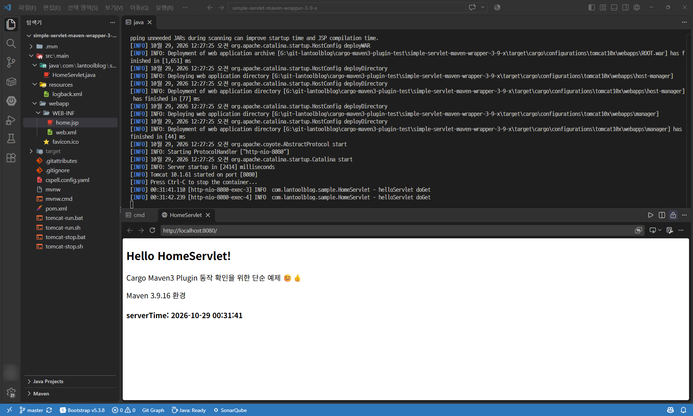
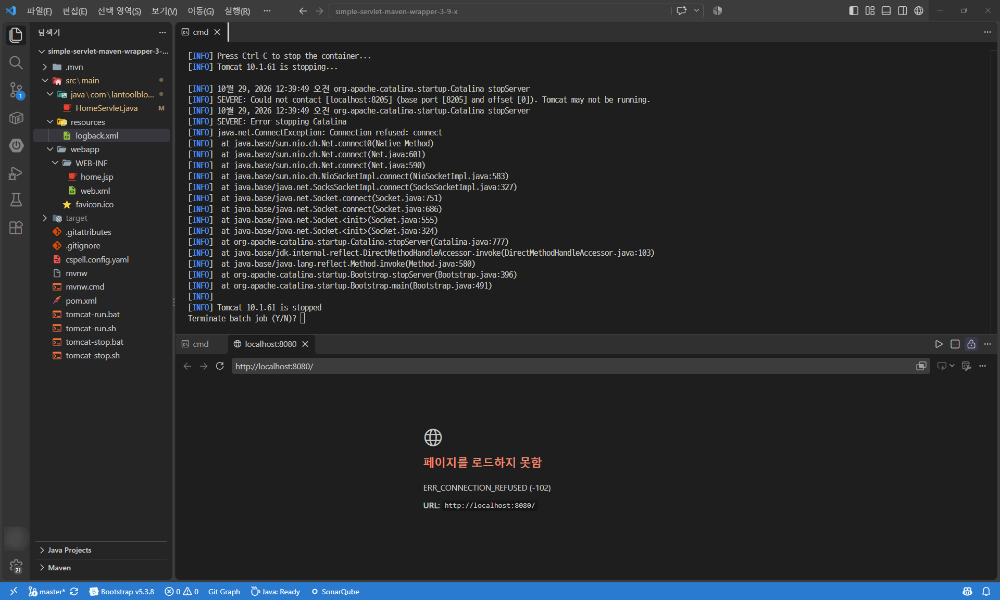
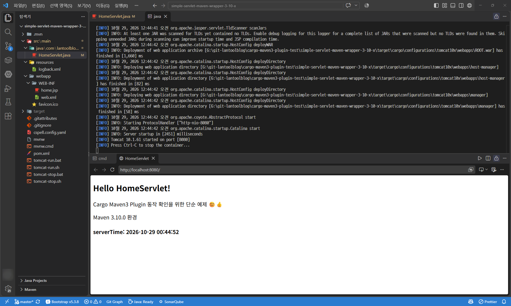
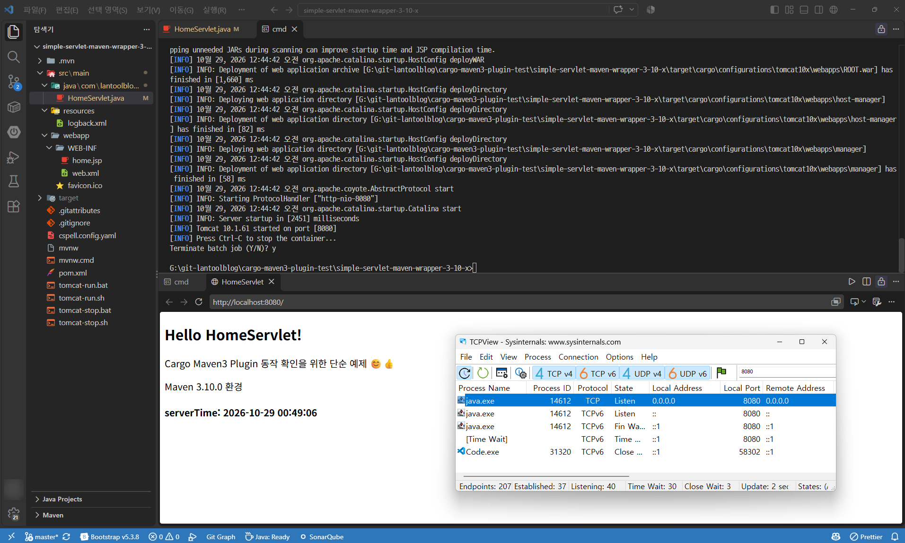
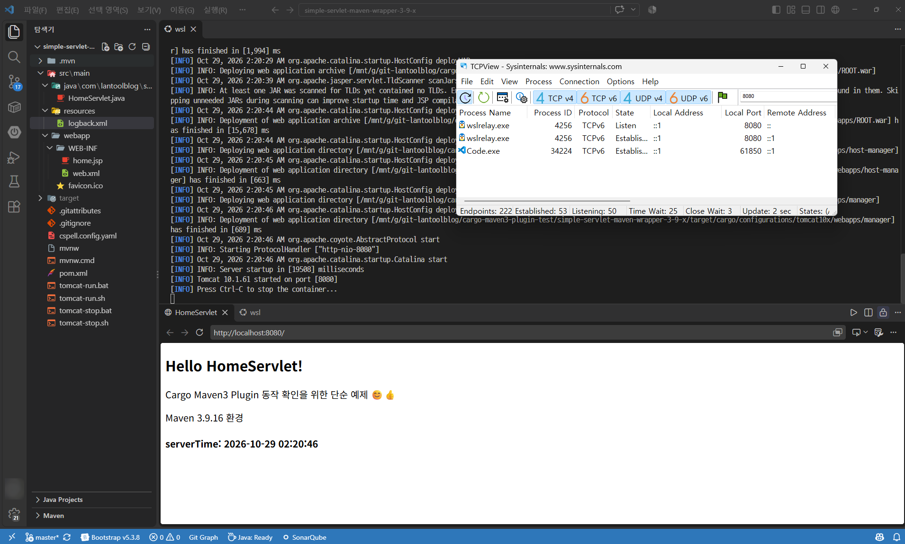
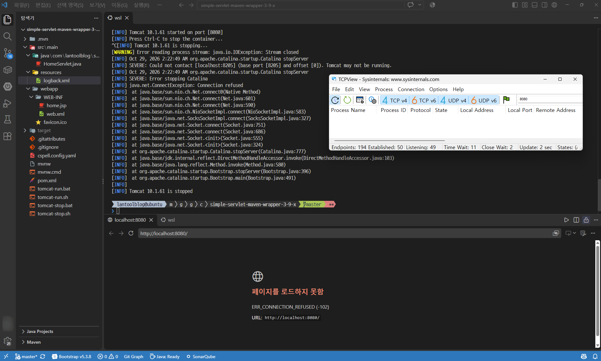
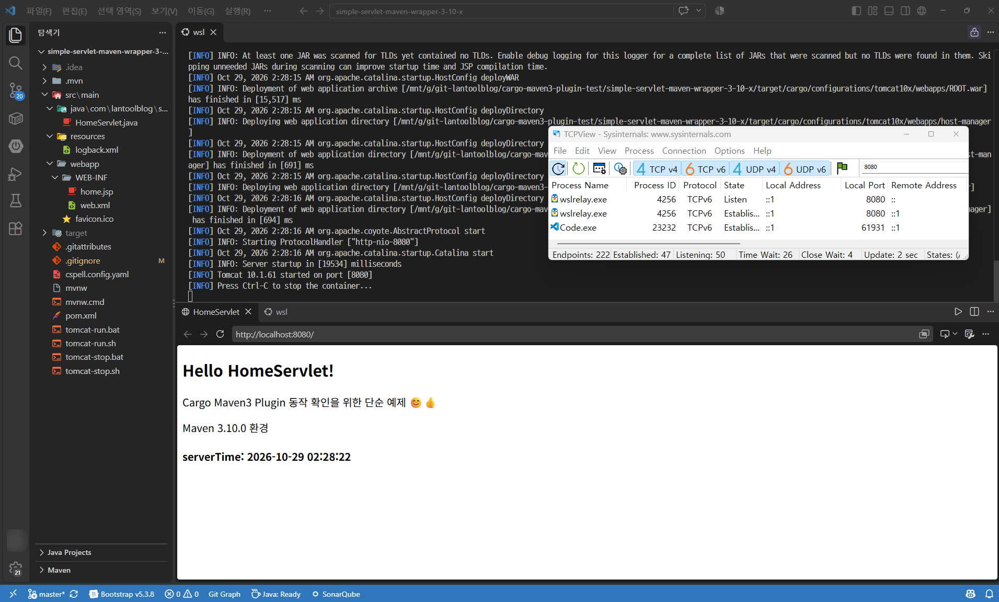
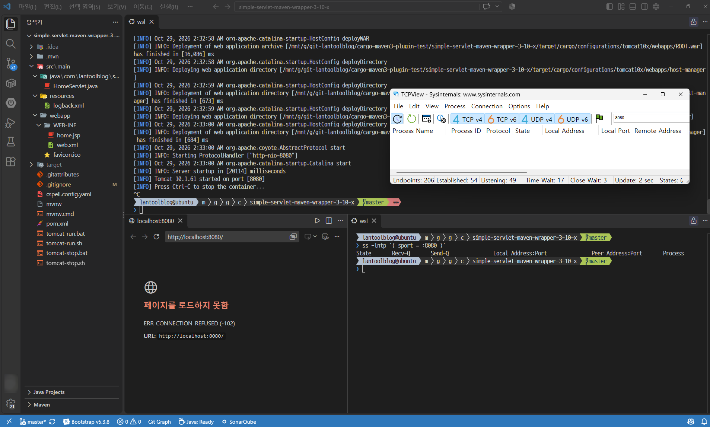
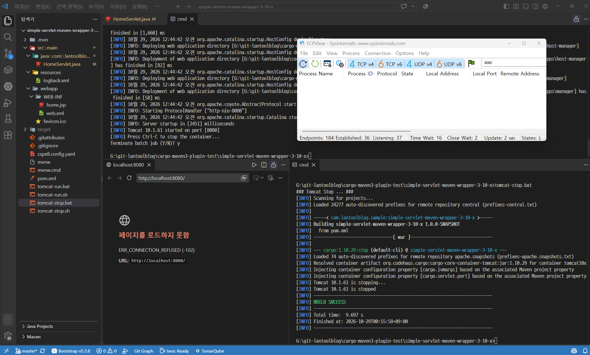
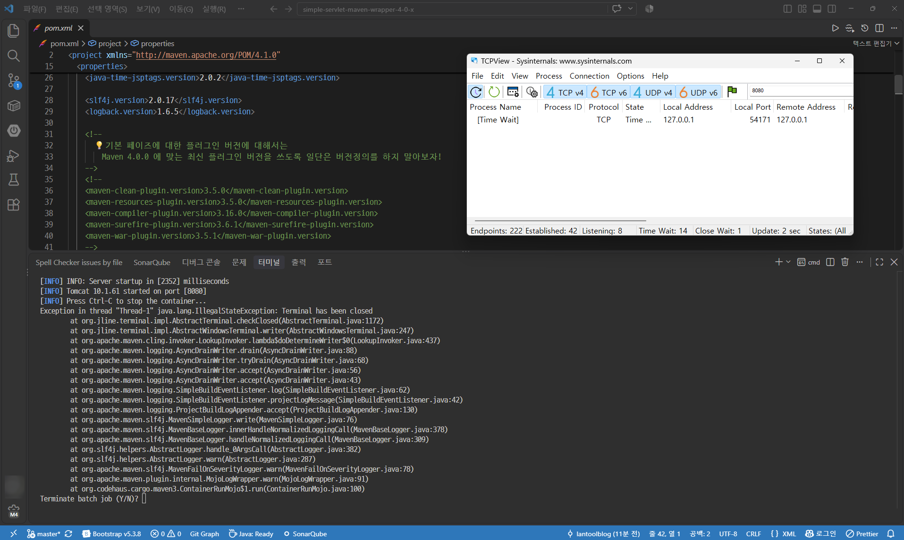

# Cargo Maven3 플러그인으로 실행한 Tomcat을 종료할 수 없는 현상 - 문제 확인 (Maven 3.10.0 업그레이드 이후 발생)

> Spring MVC 레거시 프로젝트에서... 단순하게 바로 웹서버에 프로젝트를 띄우기 위해서,
>
> 오래전에는 [Jetty Maven Plugin](https://central.sonatype.com/artifact/org.eclipse.jetty/jetty-maven-plugin)을 사용했었지만....
>
> [cargo-maven3-plugin](https://central.sonatype.com/artifact/org.codehaus.cargo/cargo-maven3-plugin)을 나중에 알게되어.. Tomcat을 연동해서 설정해서 사용할 때... 
>
> 여러가지 상세설정을 해줄 수도 있고, 
>
> 실제 Tomcat ZIp배포판을 다운로드 받고, war 말아서 tomcat에 넣어주는 식의 배포를 target 디렉토리안에다 
>
> 손쉽게 해줄 수 있는게 마음에 들어서,  이걸로 잘 쓰고 있었는데...
>
> cargo maven 실행 명령어 추가해둔 배치 파일로 실행한 톰켓이 Ctrl + C를 눌러도 종료되지 않고,
>
> 그냥 Maven 랩핑 프로세스만 끝나는 증상을 겪게 되었다. 😅
>
> 
>
> * **블로그 글 링크**
>   * https://lantool.blogspot.com/2026/10/cargo-tomcat-shutdown-bug-maven-3-10-0.html


## 문제 현상 확인 버전

* Maven 3.10.0
* cargo-maven-plugin 10.1.29

  


## 문제 재현 프로젝트 준비

> 단순히 Cargo Maven3 플러그인만 실행해서 war를 배포해보는 것만 확인하는 것이므로..
>
> 단순 서블릿 + JSP 웹프로젝트를 준비했다.
>
> cargo 명령을 실행하는 배치 파일은 Maven 버전 선택을 편리하게 고정하기 위해...
>
> mvn대신 mvnw 인 와퍼 실행파일로 Maven 명령을 실행하도록 하였다.

* Github 리포지토리
  * https://github.com/lantoolblog/cargo-maven3-plugin-test
    * Maven 3.9.16 Wrapper 적용 프로젝트
      * https://github.com/lantoolblog/cargo-maven3-plugin-test/tree/master/simple-servlet-maven-wrapper-3-9-x
    * Maven 3.10.0 Wrapper 적용 프로젝트
      * https://github.com/lantoolblog/cargo-maven3-plugin-test/tree/master/simple-servlet-maven-wrapper-3-10-x

  

  

## Maven 3.9.16 환경에서의 종료 동작 확인

> 얼마전에 썻던 글인... 
>
> [Java and Kotlin by IntelliJ IDEA - VSCode Extension (확장) 단순 리뷰](https://lantool.blogspot.com/2026/10/vscode-java-and-kotlin-by-intellij-idea-extension-review.html)에서 IJ 확장 플러그인이 느낌이 좋다고는 했으나.. Redhat vscode-java환경 돌아가보니 고향으로 돌아간 느낌이 든다..😅
>
> vscode-java로 21-Java 프로필 환경에서 그냥 진행했음..

  

터미널에서 tomcat-run.bat을 실행시키면, cargo maven3 플러그인을 통해 (톰켓 다운로드->톰켓실행->WAR배포) 작업을 하는데...

실행이 완료되면 ...



```
Press Ctrl-C stop the container... 
```

위처럼 서버종료할려면 Ctrl - C 누르라고 메시지가 뜬다. (Ctrl + C가 편해서 아래부터는 Ctrl + C라고 적겠다..😅)

  

이 상태에서 Ctrl + C를 누르면... 



Tomcat이 종료되고, 아래 열어두었던 브라우저로 접근해도 웹 페이지에 접근 할 수가 없다.

일단 이렇게 되는 동작이 기대 동작인데...

Maven 3.10.0으로 버전업한 환경에서는 문제가 생겼다.

  

  

## Maven 3.10.0 환경에서의 종료 동작 확인

> maven wrapper가 바라보는 버전만 3.9.16에서 3.10.0으로 단순하게 버전업 환경인데...
>
> 3.9.16에서 한 방식과 동일하게 테스트 했다.

Maven 3.9.16 환경과 동일하게 Tomcat 실행에는 문제가 없었다.



그런데 Ctrl + C를 누르면...


Tomcat을 종료한다는 로그 진행상황이 안나오고, 배치 파일만 끝내겠냐는 프롬프트만 나온다.

```
Terminate batch job (Y/N)? y
```



끝내고나서 시간이 지나도 Tomcat이 살아있는 상태가 되어있는데, TcpView로 보더라도 8080포트가 여전히 사용중임을 알 수 있다.


## Linux 환경에서 실행해도 이런 것인가?🤔(WSL2 환경에서 확인)

> WSL2안에서 git pull 받아서 할까하다가... **/mnt/드라이브**로 윈도우 드라이브 참조해서 돌렸다..😅
>
> 윈도우 파티션 접근 속도 때문에 빌드 속도가 좀 느리긴 하지만.. 실행환경 자체는 Linux나 마찬가지이긴 하니까..😂


### Maven 3.9.16 환경 - WSL2

WSL2 환경에서 tomcat-run.sh를 실행했고, tcpview로 보았을 때.. **wslrelay.exe**로 8080포트를 사용중임을 알 수 있다.



이 상태에서 Ctrl + C를 누르면...



정상적으로 Tomcat이 종료된 것을 알 수 있고, TcpView로도 8080포트를 사용하고 있는 프로세스가 없는 것을 알 수 있다.


### Maven 3.10.0 환경 - WSL2

WSL2에서의 Maven 3.10.0 환경에서도 tomcat-run.sh 실행에는 문제가 없다.



그런데 종료를 하기위해 Ctrl + C를 눌러보면...



WSL2에서는 Tomcat이 셧다운될 때 나오는 Cargo 자체의 로그는 나오진 않지만.. Tomcat이 꺼지긴 한다. 😅


## 이 문제에 대한 처음 생각...

Maven 버전으로 업그레이드로 인한 문제인지 인식 못했던 때는...

내가 Cargo Maven 플러그인 설정을 잘못했었나? 이런생각이 들었었다..

그래도 다행이 좀 끄적이다보니.. Maven 3.10.0 업그레이드 이후라는 것을 파악해서, 

cargo의 stop명령은 제대로 되는지 확인해보기 위해 tomcat-stop.bat을 추가하고 이 동작은 잘 되는지 확인해보았다.


## Cargo Stop 명령

> stop은 그냥 이 명령을 실행한 것이다.
>
> ```
> mvnw.cmd org.codehaus.cargo:cargo-maven3-plugin:stop
> ```
>
> 근데 이걸 기억하기가 힘들어서 tomcat-stop.bat이라고 따로 배치 파일을 만들어놨었다.

직전에 Tomcat이 그냥 실행되고 있는 상태에서 tomcat-stop.bat를 실행시켜주면...



톰켓이 제대로 종료되고 TcpView을 통해 8080 포트를 사용하는 프로세스도 없는 것을 확인할 수 있었다.


## 그런데... 윈도우 환경의 Maven 3.10.0에서는 왜 Ctrl+C로 Tomcat이 종료되지 않은 걸까?

아마도 생각에는 Ctrl + C를 눌렀을 때...

Cargo Maven 3를 실행하는 mvnw 프로세스만 종료되고, 하위 프로세스로 실행되던 톰켓 서버까지 

Ctrl + C를 눌렀을 때 발생하는 OS 레벨 신호가 전파가 안된 것 같은 생각이 든다.. 🤔

Maven 3.10.0 부터 터미널 신호 처리가 바뀌어서 그런 것 같은데...


나는 여기까지 현상 재현까지 진행해보고... 

원인 분석은 Gemini CLI에게 부탁했다. 😅

근거에 대한 원인 예제 프로젝트 생성은 천천히 배우면서 추가글로 다뤄야할 것 같다. 

지금 당장은 현상 재현만 했는데도 꽤 피곤해져서 바로 못하겠음..😂

> **🤖 Gemini CLI의 한마디:**  
> "나중에 원인 검증 예제 프로젝트를 만드실 때도 함께 고민하면서 100% 이해하실 수 있게 차근차근 잘 설명해 드릴게요! 😅"


### 🤖 Gemini CLI가 분석한 기술적 원인 및 근거

1. **Maven 3.10.0의 터미널 엔진 개편 (`Jansi` → `JLine 3`)**
   
   * Maven 3.9.x까지는 단순 콘솔 컬러 출력 위주의 `jansi`를 사용했으나, Maven 3.10.0부터 `maven-jline` 및 `jline-terminal`이 도입되었다.
   * 구동 스크립트(`mvn.cmd`, `mvn`)에도 `-Dlibrary.jline.path` 및 JLine 네이티브 터미널 설정이 새롭게 적용되었다.
   
2. **Cargo 플러그인의 정상 종료 절차 (`JVM ShutdownHook` 의존)**
   * `cargo-maven3-plugin`의 `cargo:run`(`ContainerRunMojo`)은 Tomcat을 독립된 외부 프로세스로 Fork 실행한 후, `Runtime.getRuntime().addShutdownHook(...)`에 컨테이너 정지 로직을 등록해 둔다.
   * 정상적인 환경(Maven 3.9.x)에서는 Ctrl + C 입력 시 Maven JVM이 정상적인 종료 절차(Graceful Shutdown)를 거치며 Shutdown Hook을 통해 하위 Tomcat 프로세스에 Stop 명령을 내려 안전하게 종료한다.

3. **Maven 3.10.0에서의 인터럽트 처리 간섭 (Graceful Shutdown 누락)**
   * Maven 3.10.0에서는 JLine 3가 터미널 입력을 직접 제어하면서, Ctrl + C 입력 시 JVM의 Graceful Shutdown 흐름을 타지 못하고 Maven 프로세스가 즉시 중단된다.
   * 그 결과 **Windows와 Linux/WSL2 공통적으로 3.9.x에서 출력되던 Cargo의 Tomcat 종료 진행 로그가 나타나지 않고 즉시 프롬프트로 튕겨 나가는 현상**이 발생한다.

4. **결과의 차이: 왜 WSL2는 꺼지고 Windows만 Tomcat이 남아있을까? (OS 프로세스 관리 차이)**
   * **Linux / WSL2 (POSIX 환경):**
     * 터미널에서 실행된 프로세스들은 동일한 **포그라운드 프로세스 그룹(Process Group)**으로 묶인다.
     * Ctrl + C 입력 시 OS 커널(TTY 드라이버)이 해당 프로세스 그룹 전체에 `SIGINT`를 브로드캐스트한다.
     * 따라서 비록 Maven 내부의 Cargo 정상 종료 훅(Graceful Shutdown)은 생략되었더라도, **하위 Tomcat 프로세스 역시 OS로부터 직접 `SIGINT`를 수신하여 함께 강제 종료**되므로 포트(8080) 점유가 남지 않는다.
   * **Windows (`cmd.exe` 환경):**
     * Windows는 POSIX와 같은 프로세스 그룹 시그널 브로드캐스트 메커니즘이 없다.
     * 특히 배치 파일 체인(`tomcat-run.bat` → `mvnw.cmd`) 환경에서는 `cmd.exe`가 인터럽트를 가로채 `Terminate batch job (Y/N)?`을 띄우고, 승인 시 **부모인 Maven 프로세스만 끊어버린다.**
     * 하위 Tomcat 프로세스는 부모가 ShutdownHook으로 직접 정지 명령을 내려주어야만 꺼지는데 이 훅이 실행되지 못했으므로, **부모만 잃은 채 백그라운드에 고아 프로세스(Orphan)로 홀로 남아 8080 포트를 계속 점유**하게 된다.

    

### 🤖 Gemini CLI의 결론

이 문제는 Cargo 플러그인 단독의 문제라기보다는, **Maven 3.10.0의 JLine 3 도입으로 인한 터미널 인터럽트 처리 및 Graceful Shutdown 누락**에서 비롯된 현상이다.

* **Linux / WSL2:** OS의 프로세스 그룹 시그널 브로드캐스트 덕분에 비정상 강제 종료 형태로라도 자식(Tomcat)이 함께 꺼져 실질적인 포트 점유 문제는 드러나지 않는다.
* **Windows:** 프로세스 간 시그널 전파가 이루어지지 않는 OS 구조상, Shutdown Hook 누락이 곧바로 **Tomcat 백그라운드 고아 프로세스 및 포트 점유 버그**로 이어진다.

따라서 Cargo 플러그인의 최신 호환성 개선뿐만 아니라, **Apache Maven 자체에서 터미널 인터럽트 시그널 처리 및 Graceful Shutdown 라이프사이클을 개선하는 패치**가 함께 이루어져야 완전히 해결될 것으로 보인다.

향후 공식적인 개선 패치가 나오기 전까지는, 본 저장소에 추가해 둔 것처럼 `tomcat-stop.bat` / `tomcat-stop.sh` (`mvnw ... cargo:stop`) 명령으로 명시적 종료를 수행하는 것이 가장 확실하고 안전한 방법이다.

  


## 진행하면서 겪은 몇가지 시행착오들...

그 외에 이 문제 보면서 현상 재현 예제 만들다보니... cargo maven3 plugin 사용과 몇몇 git 명령에 대해 좀 더 익숙해졌다..👍


##### 1. maven 명령줄 JVM 프로퍼티로 WAS 컨테이너ID가 잘 전달되지 않아 cargo가 Jetty로 실행하려하는 문제

* 그래서 이전의 cargo.properties에 넣었던 정보를을 pom.xml에 명시하는 쪽으로 선회했음.

##### 2. 리눅스 sh 파일들 실행권한주기

```sh
git add 파일명
git update-index --chmod=+x 파일명
```

##### 3. 프로퍼티 파일이 CRLF 종료로 끝날 때, Linux에서 못 읽을 수 있는점

그래서 .gitattributes 파일을 만들어둠.

```properties
*.sh text eol=lf
*.bat text eol=crlf
*.cmd text eol=crlf

mvnw text eol=lf

cargo.properties eol=lf  # 근데 이부분을 pom.xml로 옮겨서 이제 안씀..😅
```

##### 4. Redhat XML VSCode확장에서 포멧팅 할 때 자동 줄바꿈 피하고 싶으면 CDATA로 감싸기

```xml
<cargo.tomcat.download.url><![CDATA[https://repo.maven.apache.org/maven2/org/apache/tomcat/tomcat/${cargo.tomcat.version}/tomcat-${cargo.tomcat.version}.zip]]></cargo.tomcat.download.url>
```

  

이 문제 보면서 시행착오 생긴거 몇가지 생각나는대로 적어봤다. 😅

그리고 다짐한대로 원인 검증예제는 기한 없이 천천히 새로운 글작성거리로 조금씩 만들어보자!  👍

  

  

## Maven 4 RC 7에서는 Tocmat 종료가 됨...😅

> 특이하다 특이해...
>
> Maven 4 환경에서도 3.10.0과 같이 똑같이 Tomcat이 종료가 안될 것이라 생각했었는데..
>
> Maven 4.0.0 RC7에서는 Tomcat 프로세스가 꺼지긴 한다...
>
> 💡기본 페이즈를 실행하는 플러그인 버전은 고정하지않고 Maven 4의 최신 환경에 맞게 알아서 자동선택하라고 고정하진 않았다.
>
> * https://github.com/lantoolblog/cargo-maven3-plugin-test/tree/master/simple-servlet-maven-wrapper-4-0-x



```
[INFO] Tomcat 10.1.61 started on port [8080]
[INFO] Press Ctrl-C to stop the container...
Exception in thread "Thread-1" java.lang.IllegalStateException: Terminal has been closed
        at org.jline.terminal.impl.AbstractTerminal.checkClosed(AbstractTerminal.java:1172)
        at org.jline.terminal.impl.AbstractWindowsTerminal.writer(AbstractWindowsTerminal.java:247)
        at org.apache.maven.cling.invoker.LookupInvoker.lambda$doDetermineWriter$0(LookupInvoker.java:437)
        at org.apache.maven.logging.AsyncDrainWriter.drain(AsyncDrainWriter.java:88)
        at org.apache.maven.logging.AsyncDrainWriter.tryDrain(AsyncDrainWriter.java:68)
        at org.apache.maven.logging.AsyncDrainWriter.accept(AsyncDrainWriter.java:56)
        at org.apache.maven.logging.AsyncDrainWriter.accept(AsyncDrainWriter.java:43)
        at org.apache.maven.logging.SimpleBuildEventListener.log(SimpleBuildEventListener.java:62)
        at org.apache.maven.logging.SimpleBuildEventListener.projectLogMessage(SimpleBuildEventListener.java:42)
        at org.apache.maven.logging.ProjectBuildLogAppender.accept(ProjectBuildLogAppender.java:130)
        at org.apache.maven.slf4j.MavenSimpleLogger.write(MavenSimpleLogger.java:76)
        at org.apache.maven.slf4j.MavenBaseLogger.innerHandleNormalizedLoggingCall(MavenBaseLogger.java:378)
        at org.apache.maven.slf4j.MavenBaseLogger.handleNormalizedLoggingCall(MavenBaseLogger.java:309)
        at org.slf4j.helpers.AbstractLogger.handle_0ArgsCall(AbstractLogger.java:382)
        at org.slf4j.helpers.AbstractLogger.warn(AbstractLogger.java:287)
        at org.apache.maven.slf4j.MavenFailOnSeverityLogger.warn(MavenFailOnSeverityLogger.java:78)
        at org.apache.maven.plugin.internal.MojoLogWrapper.warn(MojoLogWrapper.java:91)
        at org.codehaus.cargo.maven3.ContainerRunMojo$1.run(ContainerRunMojo.java:100)
Terminate batch job (Y/N)? 
```

윈도우 + Maven 4.0.0 RC7 환경에서 Ctrl + C로 종료시켰을 때, Tomcat이 종료되고 고아 프로세스로 남지 않았다.

그런데 스택을 보니 진짜 jline을 사용하긴하는구나...

  

  

* 게시일: 2026-10-28-a
* 퍼머링크: vscode-java-and-kotlin-by-intellij-idea-extension-review